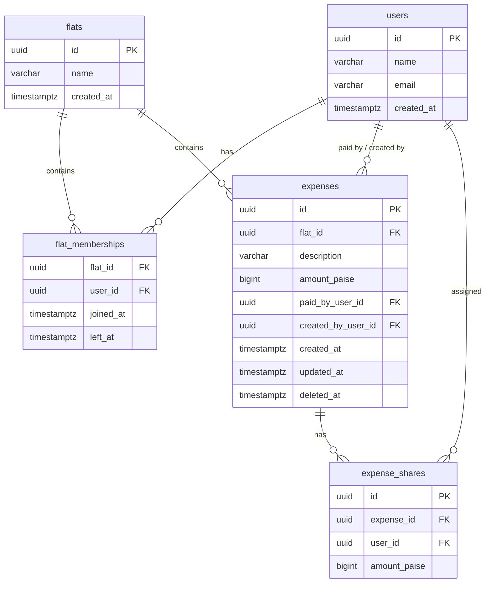

# Flatmate Ledger

**Flatmate Ledger** is a production-quality, full-stack shared flat expense tracking application. It allows people sharing a flat to record shared expenses, split bills evenly between flatmates, track individual balances, and understand who owes whom with plain-language settlement suggestions.

The system is built as a monorepo containing a **React + TypeScript frontend** (Vite, Tailwind CSS, Lucide React), a **Node.js + Express + TypeScript REST API**, and a **PostgreSQL database** accessed directly via the `pg` driver using raw SQL queries and Common Table Expressions (CTEs).

---

## Quick Start (Fresh Clone Setup in 5 Commands)

To run the complete application locally with PostgreSQL, database migrations, seed data, and both development servers running simultaneously:

```bash
# 1. Create local environment file from template (if not already present) and install dependencies
[ -f .env ] || cp .env.example .env && npm install

# 2. Start the PostgreSQL 16 container via Docker Compose
npm run docker:up

# 3. Apply SQL database migrations
npm run db:migrate

# 4. Populate realistic seed data (two flats, seven users, sample expenses)
npm run db:seed

# 5. Start both the Backend API and React Frontend concurrently
npm run dev
```

- **Frontend Application**: [http://localhost:5173](http://localhost:5173)
- **Backend REST API**: [http://localhost:4000](http://localhost:4000)
- **API Health Check**: [http://localhost:4000/api/health](http://localhost:4000/api/health)

*Note: The root `npm run dev` script uses `concurrently` to run both `apps/api` (port 4000) and `apps/web` (port 5173) simultaneously in a single terminal session.*

---

## Functional Features

1. **Deterministic Equal Money Splitting**:
   - Total amounts and individual shares are computed exclusively using **integer arithmetic in paise** (1 INR = 100 paise).
   - The base share is calculated using integer division (`total / N`).
   - Remainder paise ($total \pmod N$) are distributed deterministically (1 paise at a time) in ascending order of participant user UUIDs.
   - Guaranteed zero rounding loss: the sum of all computed shares strictly equals the total expense.
2. **Aggregated Balances with Raw SQL CTEs**:
   - Calculates member balances entirely inside PostgreSQL using separate Common Table Expressions (CTEs) for payments and shares before joining with memberships and users.
   - Prevents Cartesian product row multiplication bugs.
   - Guarantees the zero-sum ledger balance invariant: the sum of all members' net balances in a flat strictly equals zero ($\sum \text{Net Balances} = 0$).
3. **Deterministic Settlement Suggestions**:
   - Provides plain-language settlement advice (e.g., *"Aarav owes Riya ₹450.00"*).
   - Uses a deterministic greedy debtor-creditor matching heuristic that calculates settlement pairings without altering persistent database records.
4. **Soft Deletion of Expenses**:
   - Deleting an expense sets `deleted_at = NOW()`.
   - Deleted expenses immediately disappear from listings and balance aggregations while preserving historical records for auditability.
5. **Flat Member Lifecycle & Historical Integrity**:
   - Members can leave a flat via `POST /api/flats/:flatId/leave` (sets `left_at = NOW()`).
   - Departed members immediately lose access to flat operations.
   - Historical contributions and shares of departed members remain in the ledger so remaining flatmates' balances are not corrupted.
6. **Caller Identity & Demo User Switcher**:
   - Identification via trusted `X-User-Id` request header (validated against the database).
   - Sidebar UI switcher allowing evaluators to switch perspective between flatmates in real time.

---

## Technology Stack

- **Frontend**: React 18, TypeScript, Vite, Tailwind CSS, React Router v6, Lucide React icons.
- **Backend**: Node.js 22, Express.js, TypeScript, PostgreSQL (via direct `pg` pool queries), Zod schema validation.
- **Testing**: Vitest, Supertest, PostgreSQL-backed integration test suite.
- **Infrastructure**: Docker Compose (PostgreSQL 16 Alpine), GitHub Actions CI.

---

## Monorepo Architecture

```
flatmate-ledger/
├── apps/
│   ├── api/                     # Node.js + Express TypeScript REST API
│   │   ├── src/
│   │   │   ├── db/              # pg Pool, migration runner, seed runner
│   │   │   ├── errors/          # Custom ApiError hierarchy
│   │   │   ├── middleware/      # Auth (X-User-Id), membership check, error handler
│   │   │   ├── routes/          # Health, demo users, flats, expenses, balances
│   │   │   ├── utils/           # Integer split and settlement algorithms
│   │   │   ├── server.ts        # Express app configuration
│   │   │   └── index.ts         # Server entry point
│   │   └── test/
│   │       ├── unit/            # Money splitting & property-based tests
│   │       └── integration/     # PostgreSQL-backed API integration tests
│   └── web/                     # React + Vite TypeScript frontend
│       ├── src/
│       │   ├── components/      # Sidebar, Header, Modal, ConfirmDialog, EmptyState
│       │   ├── context/         # AppContext (active user, flat, refresh state)
│       │   ├── pages/           # Dashboard, Expenses, Balances, Members
│       │   ├── services/        # Fetch API client with X-User-Id header injection
│       │   └── utils/           # Currency formatting and safe paise parser
│       └── vite.config.ts       # Vite proxy configuration (/api -> :4000)
├── database/
│   ├── migrations/              # SQL schema migration files
│   └── seeds/                   # Seed data SQL files
├── .github/
│   └── workflows/ci.yml         # GitHub Actions CI workflow
├── docker-compose.yml           # PostgreSQL container definition
├── .env.example                 # Environment configuration template
├── package.json                 # Monorepo workspaces definition
├── README.md                    # Project documentation
├── DECISIONS.md                 # Architecture and technical decisions
├── PREVIOUS_WORK.md             # Prior project discussion
└── AI_USAGE.md                  # Development tools & debugging notes
```

---

## Database Schema & Indexing Strategy



### Tables & Relationships
- **users**: Stores registered members (`id` UUID PK, `name`, `email` UNIQUE, `created_at`).
- **flats**: Represents shared living units (`id` UUID PK, `name`, `created_at`).
- **flat_memberships**: Join table with composite primary key `(flat_id, user_id)`. Tracks `joined_at` and nullable `left_at`.
- **expenses**: Tracks flat expenses (`id` UUID PK, `flat_id` FK, `description`, `amount_paise` BIGINT, `paid_by_user_id` FK, `created_by_user_id` FK, `created_at`, `updated_at`, `deleted_at`).
- **expense_shares**: Tracks per-member shares (`id` UUID PK, `expense_id` FK, `user_id` FK, `amount_paise` BIGINT, with UNIQUE constraint on `(expense_id, user_id)`).

### Indexing Strategy
```sql
CREATE INDEX idx_expenses_flat_active
ON expenses(flat_id, created_at DESC, id DESC)
WHERE deleted_at IS NULL;
```

**Why this index is useful:**
- **Partial Predicate**: Filtering on `WHERE deleted_at IS NULL` keeps soft-deleted rows out of the index, keeping index size small and cache-resident.
- **Query Plan Alignment**: Aligns with the primary listing query (`WHERE flat_id = $1 AND deleted_at IS NULL ORDER BY created_at DESC, id DESC LIMIT $3 OFFSET $4`), allowing PostgreSQL to evaluate the filter and sort order directly via index traversal.
- **Supporting Indexes**: Foreign key indexes on `expense_shares(expense_id)`, `expense_shares(user_id)`, and `flat_memberships(user_id)` accelerate join and aggregation performance.

---

## Seed Data & Demo Users

The database includes two flats with seven realistic members and pre-populated expenses:

### Flat 1: Maple Residency (`11111111-1111-1111-1111-111111111111`)

| Name | Email | User UUID | Status |
| :--- | :--- | :--- | :--- |
| **Sumukh Bansal** (Default) | `sumukh@example.com` | `00000000-0000-0000-0000-000000000001` | Active Member |
| **Aarav Sharma** | `aarav@example.com` | `00000000-0000-0000-0000-000000000002` | Active Member |
| **Riya Verma** | `riya@example.com` | `00000000-0000-0000-0000-000000000003` | Active Member |
| **Karan Mehta** | `karan@example.com` | `00000000-0000-0000-0000-000000000004` | Active Member |

### Flat 2: Cedar Heights (`22222222-2222-2222-2222-222222222222`)

| Name | Email | User UUID | Status |
| :--- | :--- | :--- | :--- |
| **Dev Malhotra** | `dev@example.com` | `00000000-0000-0000-0000-000000000005` | Active Member |
| **Ananya Singh** | `ananya@example.com` | `00000000-0000-0000-0000-000000000006` | Active Member |
| **Ishaan Gupta** | `ishaan@example.com` | `00000000-0000-0000-0000-000000000007` | Active Member |

---

## REST API Reference

All protected endpoints require caller identity via the HTTP header:
`X-User-Id: <user-uuid>`

| Method | Endpoint | Description | Status Codes |
| :--- | :--- | :--- | :--- |
| `GET` | `/api/health` | Service health check | `200` |
| `GET` | `/api/demo-users` | List demo users and their flat memberships | `200` |
| `GET` | `/api/flats` | List flats for caller identity | `200`, `401` |
| `GET` | `/api/flats/:flatId/members` | Get active and departed members of a flat | `200`, `401`, `403` |
| `POST` | `/api/flats/:flatId/leave` | Leave flat (records `left_at` timestamp) | `200`, `400`, `401`, `403` |
| `GET` | `/api/flats/:flatId/expenses` | Paginated non-deleted expenses (`created_at DESC, id DESC`) | `200`, `401`, `403` |
| `POST` | `/api/flats/:flatId/expenses` | Create new expense with transactional shares | `201`, `400`, `401`, `403` |
| `PUT` | `/api/flats/:flatId/expenses/:expenseId` | Update expense & replace shares (creator only) | `200`, `400`, `401`, `403`, `404` |
| `DELETE` | `/api/flats/:flatId/expenses/:expenseId` | Soft delete expense (creator only) | `200`, `401`, `403`, `404` |
| `GET` | `/api/flats/:flatId/balances` | Aggregated balances (SQL CTE) & settlements | `200`, `401`, `403` |

### Standard Error Response Format

```json
{
  "error": {
    "code": "VALIDATION_ERROR",
    "message": "Please check the submitted data.",
    "details": {
      "amountPaise": "Amount must be greater than zero."
    }
  }
}
```

---

## Example API Requests (cURL)

### 1. Record an Expense (₹1,500.00 = 150000 paise split 3 ways)
```bash
curl -X POST http://localhost:4000/api/flats/11111111-1111-1111-1111-111111111111/expenses \
  -H "Content-Type: application/json" \
  -H "X-User-Id: 00000000-0000-0000-0000-000000000001" \
  -d '{
    "description": "Weekly Groceries",
    "amountPaise": 150000,
    "paidByUserId": "00000000-0000-0000-0000-000000000001",
    "splitBetweenUserIds": [
      "00000000-0000-0000-0000-000000000001",
      "00000000-0000-0000-0000-000000000002",
      "00000000-0000-0000-0000-000000000003"
    ]
  }'
```

### 2. Fetch Flat Balances & Settlement Suggestions
```bash
curl -X GET http://localhost:4000/api/flats/11111111-1111-1111-1111-111111111111/balances \
  -H "X-User-Id: 00000000-0000-0000-0000-000000000001"
```

### 3. Leave a Flat
```bash
curl -X POST http://localhost:4000/api/flats/11111111-1111-1111-1111-111111111111/leave \
  -H "X-User-Id: 00000000-0000-0000-0000-000000000004"
```

---

## Automated Testing

The project includes unit tests for money calculation and settlement logic, as well as integration tests backed by an isolated PostgreSQL test database (`flatmate_ledger_test`).

Run all tests:
```bash
npm run test
```

### Verified Test Scenarios:
- **Integer Split Invariant**: Property-based test iterating over 1,000 distinct totals and participant counts verifying that the sum of shares strictly equals the original total with 0 paise loss.
- **Equal & Uneven Remainder**: Correct deterministic distribution of remainder paise (e.g., 100 paise between 3 participants = 34, 33, 33).
- **Authentication**: Rejection of missing, malformed, or unauthorized `X-User-Id`.
- **Flat Isolation**: Rejection of cross-flat resource access (403 Forbidden).
- **Ownership Verification**: Only expense creators can edit or soft-delete expenses.
- **Soft Deletion Removal**: Verifying that soft-deleted items vanish from listings and balance calculations.
- **Zero-Sum Ledger**: SQL CTE balances query verification ensuring the sum of net balances is zero.
- **Stable Pagination**: Secondary sort by `id DESC` when timestamps match.
- **Departed Members**: Access revocation upon leaving, while historical balances remain preserved.

---

## Production Build & Verification

```bash
# Type check and build both apps
npm run build
```

Both applications compile cleanly into their respective `dist/` directories without TypeScript or bundler errors.
